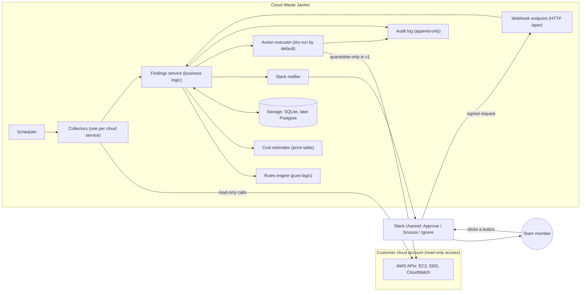

# Cloud Waste Janitor

Finds forgotten, costly cloud resources, tells your team in Slack what each one costs per month, and only acts after a human approves.

> Status: **Phase 1 complete (rules engine).** The decision logic, cost estimates, safety state machine, structured logging and configuration are built and tested on sample data. It does not connect to a real cloud account yet (that is Phase 2). Design documents: `01-design-doc.md`, `02-threat-model.md`, `03-test-plan.md`.

## The problem in plain words

Companies create cloud resources (disks, servers, backups, IP addresses) and forget to remove them. Nobody notices because each item costs only a little, but together they commonly waste a large share of the cloud bill. The Janitor looks for these items, shows the monthly cost, and asks a person before touching anything.

Think of a building caretaker who walks the halls, finds lights left on in empty rooms, and leaves a note for the manager. The caretaker never switches anything off without the manager saying yes.

## System Architecture Diagram



**How to read it:** the Scheduler wakes up on a timer. Collectors look at the cloud account (read-only). The Findings service asks the Rules engine "is this wasteful?" and the Cost estimator "how much per month?", saves the result, and tells the team in Slack. A person clicks a button. Slack sends a signed message to our Webhook, and only then can the Action executor do anything, and in version 1 it can only quarantine, never delete.

**Built so far (Phase 1):** Rules engine, Cost estimator, the evaluator part of the Findings service, and the finding life-cycle rules. Everything else in the diagram arrives in later phases.

## What works today

Given a list of cloud resources and a history of what the Janitor has seen before, it produces a report:

| Rule | Flags | Default |
|------|-------|---------|
| Unattached disk | Disk not attached to anything | 14 days or more |
| Idle server | Running server with very low CPU and network use | under 5% CPU and under 5 MB/day for 14 days |
| Old snapshot | Backup copy not used by any machine image | 90 days or more |
| Unused IP | Elastic IP address attached to nothing | immediately |

Each finding comes with a reason, the evidence, and an **estimated** monthly cost. The report totals the money at stake. Things it cannot judge (missing metrics, unreadable dates) are listed separately instead of guessed. Anything tagged `janitor:ignore=true` is left alone.

## Safety promises

1. Read-only access first.
2. Short-lived credentials, never permanent keys.
3. Secrets in environment variables only.
4. Dry-run by default.
5. Quarantine and backup before any change.
6. Nothing is deleted in version 1.
7. Kill switch stops all actions instantly (`JANITOR_ACTIONS_ENABLED`, off unless set to `true`).
8. Every decision is written to an audit log.

## Project layout

```
src/
  core/          business logic only (no cloud, HTTP or database code)
    rules/       the four waste rules
    cost/        price table and cost estimator
    evaluator.ts applies rules, attaches costs, builds the report
    stateMachine.ts  allowed life-cycle of a finding
    history.ts   "how long has it been in this state?"
    validate.ts  checks outside data before it is trusted
    types.ts
  config/        validated settings from environment variables
  logging/       structured JSON logger with secret redaction
test/
  unit/          one test file per module
  fixtures/      sample accounts (clean, wasteful, mixed)
.github/workflows/ci.yml   runs the checks on every pull request
```

## Settings (environment variables, all optional)

| Variable | Default | Meaning |
|----------|---------|---------|
| `JANITOR_UNATTACHED_DAYS` | 14 | Days a disk must be unattached |
| `JANITOR_IDLE_WINDOW_DAYS` | 14 | Days of metrics needed to judge a server |
| `JANITOR_IDLE_CPU_PERCENT` | 5 | Average CPU below this counts as idle |
| `JANITOR_IDLE_NETWORK_BYTES_PER_DAY` | 5000000 | Average traffic below this counts as idle |
| `JANITOR_SNAPSHOT_MAX_AGE_DAYS` | 90 | Age at which an unused snapshot is flagged |
| `JANITOR_ACTIONS_ENABLED` | false | Kill switch. Must be exactly `true` to allow changes |
| `JANITOR_LOG_LEVEL` | INFO | DEBUG, INFO, WARN or ERROR |

## Running the checks

```
npm ci              # install exact versions from the lockfile
npm run typecheck   # check the types
npm test            # run the tests
npm run test:coverage
npm run build
```

GitHub runs the same checks automatically on every pull request and every push to `main` (see the green tick or red cross next to a commit).

## Design notes for Phase 1

- **Prices are estimates.** The price table (`src/core/cost/priceTable.ts`) is stamped with the date it was checked (2026-10-29) and covers us-east-1 only. Unknown regions, volume types or server types are reported as "cannot estimate" and are never counted as zero. Disk prices cover storage only (extra IOPS and throughput are not included). Snapshot prices are an upper bound because AWS bills only changed data.
- **Disk age comes from our own history.** AWS does not say how long a disk has been unattached, so the Janitor records what it sees on each run. Known limitation: if the Janitor stops running for a long time, a disk could be attached and detached in the gap unnoticed. A later phase adds a freshness check.
- **Bad data never crashes a run.** Malformed resources are skipped, logged with a reason, and listed in the report.
- **Test confidence.** Expected figures in the tests were calculated by hand and re-checked with an independent script. The tests were also checked by deliberately breaking the code in 16 ways; every break was caught.

## Roadmap

| Phase | Deliverable | Status |
|-------|-------------|--------|
| 0 | Design doc, architecture diagram, threat model, test plan | Done |
| 1 | Rules engine with sample data and tests | Done |
| 2 | Collectors tested against moto (fake AWS) | Next |
| 3 | Command-line report with total monthly savings (first demo) | |
| 4 | Slack alerts | |
| 5 | Approvals and safe actions | |
| 6 | Dashboard (optional web view) | |
| 7 | README polish, demo video, launch | |

## Tech

TypeScript, Node.js, Jest, SQLite (later). All free tools. See the design doc for the reasons behind each choice.
