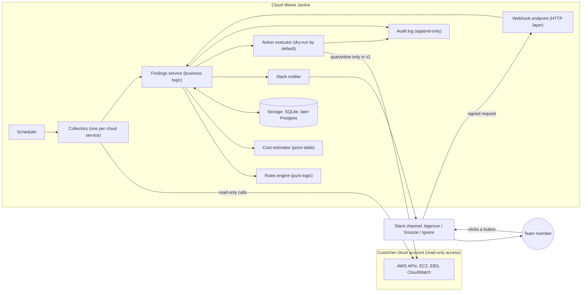

# Cloud Waste Janitor

Finds forgotten, costly cloud resources, tells your team in Slack what each one costs per month, and only acts after a human approves.

> Status: **Phase 0 (design)**. No code yet. See `01-design-doc.md`, `02-threat-model.md`, `03-test-plan.md`.

## The problem in plain words

Companies create cloud resources (disks, servers, backups, IP addresses) and forget to remove them. Nobody notices because each item costs only a little, but together they commonly waste a large share of the cloud bill. The Janitor looks for these items, shows the monthly cost, and asks a person before touching anything.

Think of a building caretaker who walks the halls, finds lights left on in empty rooms, and leaves a note for the manager. The caretaker never switches anything off without the manager saying yes.

## System Architecture Diagram

**How to read it:** the Scheduler wakes up on a timer. Collectors look at the cloud account (read-only). The Findings service asks the Rules engine "is this wasteful?" and the Cost estimator "how much per month?", saves the result, and tells the team in Slack. A person clicks a button. Slack sends a signed message to our Webhook, and only then can the Action executor do anything, and in version 1 it can only quarantine, never delete.

## Safety promises

1. Read-only access first.
2. Short-lived credentials, never permanent keys.
3. Secrets in environment variables only.
4. Dry-run by default.
5. Quarantine and backup before any change.
6. Nothing is deleted in version 1.
7. Kill switch stops all actions instantly.
8. Every decision is written to an audit log.

## Roadmap

| Phase | Deliverable |
|-------|-------------|
| 0 | Design doc, architecture diagram, threat model, test plan (this) |
| 1 | Rules engine with sample data and tests |
| 2 | Collectors tested against moto (fake AWS) |
| 3 | Command-line report with total monthly savings (first demo) |
| 4 | Slack alerts |
| 5 | Approvals and safe actions |
| 6 | Dashboard (optional web view) |
| 7 | README polish, demo video, launch |

## Tech

TypeScript, Node.js, Jest, SQLite. All free tools. See the design doc for the reasons behind each choice.
