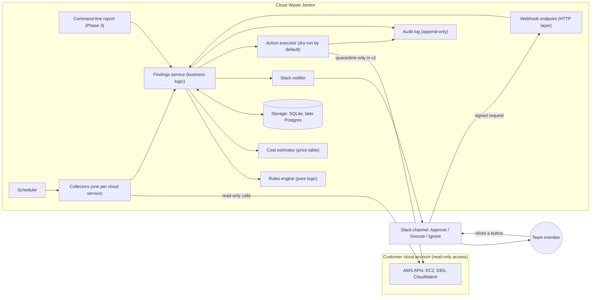
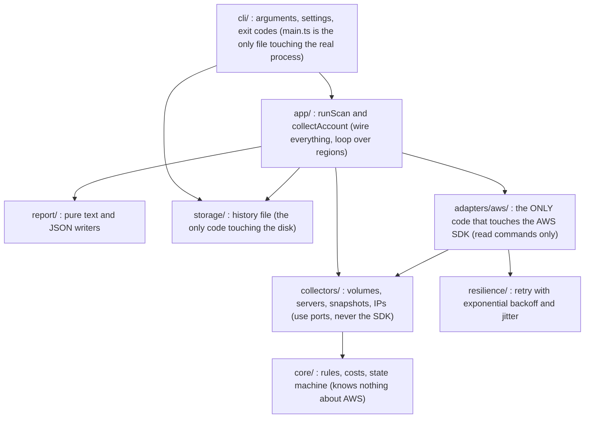

# Cloud Waste Janitor

Finds forgotten, costly cloud resources, tells your team in Slack what each one costs per month, and only acts after a human approves.

> Status: **Phase 3 complete (command-line report).** One command scans an AWS account (read-only), remembers what it saw, judges it with the rules and prints a report with the total monthly savings. Proven against a fake AWS server (moto) and with fakes in unit tests; not yet pointed at a real account. Next up is Slack alerts (Phase 4). Design documents: `01-design-doc.md`, `02-threat-model.md`, `03-test-plan.md`, `04-phase-2-design.md`, `05-phase-3-design.md`.

## The problem in plain words

Companies create cloud resources (disks, servers, backups, IP addresses) and forget to remove them. Nobody notices because each item costs only a little, but together they commonly waste a large share of the cloud bill. The Janitor looks for these items, shows the monthly cost, and asks a person before touching anything.

Think of a building caretaker who walks the halls, finds lights left on in empty rooms, and leaves a note for the manager. The caretaker never switches anything off without the manager saying yes.

## System Architecture Diagram



**How to read it:** the Scheduler wakes up on a timer. Collectors look at the cloud account (read-only). The Findings service asks the Rules engine "is this wasteful?" and the Cost estimator "how much per month?", saves the result, and tells the team in Slack. A person clicks a button. Slack sends a signed message to our Webhook, and only then can the Action executor do anything, and in version 1 it can only quarantine, never delete.

**Built so far (Phases 1 to 3):** Rules engine, Cost estimator, the evaluator part of the Findings service, the finding life-cycle rules, the Collectors with their read-only AWS access, retries and error handling, and the command-line report with its history file. Everything else in the diagram arrives in later phases.

**Inside the Collectors box (Phase 2):** the layers only point one way, and tests enforce it.



## What works today

Given a list of cloud resources and a history of what the Janitor has seen before, it produces a report:

| Rule | Flags | Default |
|------|-------|---------|
| Unattached disk | Disk not attached to anything | 14 days or more |
| Idle server | Running server with very low CPU and network use | under 5% CPU and under 5 MB/day for 14 days |
| Old snapshot | Backup copy not used by any machine image | 90 days or more |
| Unused IP | Elastic IP address attached to nothing | immediately |

Each finding comes with a reason, the evidence, and an **estimated** monthly cost. The report totals the money at stake. Things it cannot judge (missing metrics, unreadable dates) are listed separately instead of guessed. Anything tagged `janitor:ignore=true` is left alone.

## Try it: the command-line report (Phase 3)

```
npm ci
npm run build
node dist/cli/main.js scan
```

(AWS credentials come from `AWS_ACCESS_KEY_ID` and `AWS_SECRET_ACCESS_KEY` in your environment.) An example report:

```
CLOUD WASTE JANITOR REPORT
==========================
Account:    123456789012
Regions:    us-east-1 (1 of 1 scanned)
Checked:    2 resources

POTENTIAL SAVINGS
  $3.65 per month  (about $43.80 per year)

FINDINGS (1)

1. $3.65/month  Unused IP address: eipalloc-0abc... (IP address, us-east-1)
   Why:  Elastic IP address is not attached to anything
   Cost: $0.005/hour x 730 hours

DISKS BEING WATCHED (1)
  - vol-0def... (us-east-1): unattached for 0 of 14 days
```

| Option | Meaning |
|--------|---------|
| `--format json` | Machine-readable report for scripts (the report goes to stdout, log lines to stderr) |
| `--history-file <path>` | Where the Janitor remembers what it saw (default `.janitor/history.json`) |
| `--no-history` | Do not read or write a history file (disks then cannot be judged by age) |
| `--help`, `--version` | Help and version |

**Why a history file?** AWS does not say how long a disk has been unattached, so the Janitor writes down what it sees on every run. A disk first seen today shows as "watched" and is flagged once it has been unattached for 14 days. The file is saved safely (never half-written), kept small, and a damaged file stops the run instead of being overwritten.

**Exit codes:** `0` done, `1` unexpected error, `2` bad usage or settings, `3` scan incomplete (a report is still printed, with a warning), `4` history file problem.

## Reading an AWS account (Phase 2)

Four collectors, one per kind of resource, each run once per region you ask for:

| Collector | Reads | Notes |
|-----------|-------|-------|
| Volumes | `ec2:DescribeVolumes` | Disks and whether they are attached |
| Servers | `ec2:DescribeInstances`, `cloudwatch:GetMetricStatistics` | Daily CPU and network for the idle window; a server too new for the window is reported as "not enough data", never as idle |
| Snapshots | `ec2:DescribeSnapshots`, `ec2:DescribeImages` | Only snapshots your own account owns; "used by an image" comes from your own images. If the image list cannot be read, the collector fails instead of guessing "unused" |
| Elastic IPs | `ec2:DescribeAddresses` | Bring-your-own addresses are skipped because AWS does not charge for them |

How it stays safe and honest:

- **Read-only, and proven by tests.** The access policy in `policies/collector-readonly-policy.json` lists exactly the six actions above and nothing else (asking AWS "which account am I?" needs no permission). A test fails if the code ever uses a command that is not in the policy, or any command that creates, changes or deletes.
- **Role with External ID.** To scan another account, set `JANITOR_ROLE_ARN` and `JANITOR_EXTERNAL_ID`. A role without an External ID is refused (this blocks the "confused deputy" attack, see threat T4). `policies/trust-policy.example.json` shows the matching trust policy. The External ID is hidden in logs.
- **Retries with backoff.** Throttling, timeouts, network problems and AWS server errors are retried with exponential backoff and random jitter (default 5 attempts, 0.5 s start, 20 s cap). Permission and login errors are never retried. Every retry is logged.
- **One failure never hides the rest.** If one collector or one region fails, the others still run and the failure is listed. A run with failures is marked incomplete rather than silently reporting "nothing found".
- **Checked twice.** The runner re-checks what each collector returns (right type, region, account, no duplicates) before anything reaches the rules.

## Safety promises

1. Read-only access first.
2. Short-lived credentials, never permanent keys.
3. Secrets in environment variables only.
4. Dry-run by default.
5. Quarantine and backup before any change.
6. Nothing is deleted in version 1.
7. Kill switch stops all actions instantly (`JANITOR_ACTIONS_ENABLED`, off unless set to `true`).
8. Every decision is written to an audit log.

## Project layout

```
src/
  cli/           command-line front door: arguments, settings, exit codes
  report/        pure text and JSON report writers
  storage/       the history file (the only code that touches the disk)
  app/           runScan and collectAccount: wire config, clients, collectors and regions together
  collectors/    one collector per resource type, plus the runner (talk to "ports", never the SDK)
  adapters/aws/  the only code that uses the AWS SDK: clients, readers, error classification
  resilience/    retry with exponential backoff and jitter (knows nothing about AWS)
  core/          business logic only (no cloud, HTTP or database code)
    rules/       the four waste rules
    cost/        price table and cost estimator
    evaluator.ts applies rules, attaches costs, builds the report
    stateMachine.ts  allowed life-cycle of a finding
    history.ts   "how long has it been in this state?"
    validate.ts  checks outside data before it is trusted
    types.ts
  config/        validated settings from environment variables
  logging/       structured JSON logger with secret redaction
policies/        read-only access policy and an example trust policy for customers
test/
  unit/          one test file per module, plus architecture and policy checks
  integration/   the real AWS SDK and the real CLI against moto (fake AWS)
scripts/smoke.js runs the compiled program as a real process against moto
  fixtures/      sample accounts (clean, wasteful, mixed)
.github/workflows/ci.yml   runs the checks on every pull request
```

## Settings (environment variables, all optional)

| Variable | Default | Meaning |
|----------|---------|---------|
| `JANITOR_UNATTACHED_DAYS` | 14 | Days a disk must be unattached |
| `JANITOR_IDLE_WINDOW_DAYS` | 14 | Days of metrics needed to judge a server |
| `JANITOR_IDLE_CPU_PERCENT` | 5 | Average CPU below this counts as idle |
| `JANITOR_IDLE_NETWORK_BYTES_PER_DAY` | 5000000 | Average traffic below this counts as idle |
| `JANITOR_SNAPSHOT_MAX_AGE_DAYS` | 90 | Age at which an unused snapshot is flagged |
| `JANITOR_AWS_REGIONS` | us-east-1 | Comma-separated regions to scan (at most 30) |
| `JANITOR_ROLE_ARN` | not set | Role to assume in the customer account |
| `JANITOR_EXTERNAL_ID` | not set | Required whenever a role is set |
| `JANITOR_AWS_MAX_ATTEMPTS` | 5 | Tries per AWS call, from 1 to 10 |
| `JANITOR_AWS_ENDPOINT` | not set | Only for tests: point the SDK at a fake AWS such as moto |
| `JANITOR_ACTIONS_ENABLED` | false | Kill switch. Must be exactly `true` to allow changes |
| `JANITOR_LOG_LEVEL` | INFO | DEBUG, INFO, WARN or ERROR |

## Running the checks

```
npm ci              # install exact versions from the lockfile
npm run typecheck   # check the types
npm test            # run the tests
npm run test:coverage
npm run build
npm run test:smoke   # needs moto, see below
```

AWS credentials are read from the standard environment variables (`AWS_ACCESS_KEY_ID`, `AWS_SECRET_ACCESS_KEY`), never from files in this project.

### Integration tests (optional on your own computer)

These run the real AWS SDK against moto, a free fake AWS. You need Python and `pip install "moto[server]==5.2.5"`. In one terminal start the fake AWS:

```
moto_server -p 5555
```

In a second terminal, on macOS or Linux:

```
AWS_ACCESS_KEY_ID=testing AWS_SECRET_ACCESS_KEY=testing MOTO_ENDPOINT=http://127.0.0.1:5555 npm run test:integration
```

On Windows PowerShell:

```
$env:AWS_ACCESS_KEY_ID="testing"; $env:AWS_SECRET_ACCESS_KEY="testing"; $env:MOTO_ENDPOINT="http://127.0.0.1:5555"; npm run test:integration
```

The smoke test (`npm run build` first, then `npm run test:smoke`) uses the same variables.

GitHub runs the unit tests, the integration tests and the build automatically on every pull request and every push to `main` (see the green tick or red cross next to a commit).

## Design notes for Phase 1

- **Prices are estimates.** The price table (`src/core/cost/priceTable.ts`) is stamped with the date it was checked (2026-10-29) and covers us-east-1 only. Unknown regions, volume types or server types are reported as "cannot estimate" and are never counted as zero. Disk prices cover storage only (extra IOPS and throughput are not included). Snapshot prices are an upper bound because AWS bills only changed data.
- **Disk age comes from our own history.** AWS does not say how long a disk has been unattached, so the Janitor records what it sees on each run. Known limitation: if the Janitor stops running for a long time, a disk could be attached and detached in the gap unnoticed. A later phase adds a freshness check.
- **Bad data never crashes a run.** Malformed resources are skipped, logged with a reason, and listed in the report.
- **Test confidence.** Expected figures in the tests were calculated by hand and re-checked with an independent script. The tests were also checked by deliberately breaking the code in 16 ways; every break was caught.

## Design notes for Phase 2

- **Moto is a fake, and the tests say what it cannot do.** It cannot simulate throttling, permission errors or page sizes, so those are covered by unit tests with fakes. It cannot backdate resources either, so integration tests move the Janitor's clock forward to simulate "weeks later".
- **The SDK does not retry on its own** (`maxAttempts: 1`). Only our retry layer retries, so every attempt is logged and counted.
- **Not yet tried on a real account.** Everything is verified against the fake AWS. A first run on a real, low-risk account should be done with the read-only policy and watched.

## Design notes for Phase 3

- **Report on stdout, logs on stderr**, so `node dist/cli/main.js scan --format json > report.json` gives a clean file.
- **A scan that could not see everything never looks like "all clear".** The report carries a loud banner and the exit code is 3.
- **No new dependencies.** The argument parser is about 80 lines; fewer packages means fewer things to go stale.
- **Still read-only.** Nothing in this phase can change a cloud account.

## Roadmap

| Phase | Deliverable | Status |
|-------|-------------|--------|
| 0 | Design doc, architecture diagram, threat model, test plan | Done |
| 1 | Rules engine with sample data and tests | Done |
| 2 | Collectors tested against moto (fake AWS) | Done |
| 3 | Command-line report with total monthly savings (first demo) | Done |
| 4 | Slack alerts | Next |
| 5 | Approvals and safe actions | |
| 6 | Dashboard (optional web view) | |
| 7 | README polish, demo video, launch | |

## Tech

TypeScript, Node.js, Jest, SQLite (later). All free tools. See the design doc for the reasons behind each choice.
